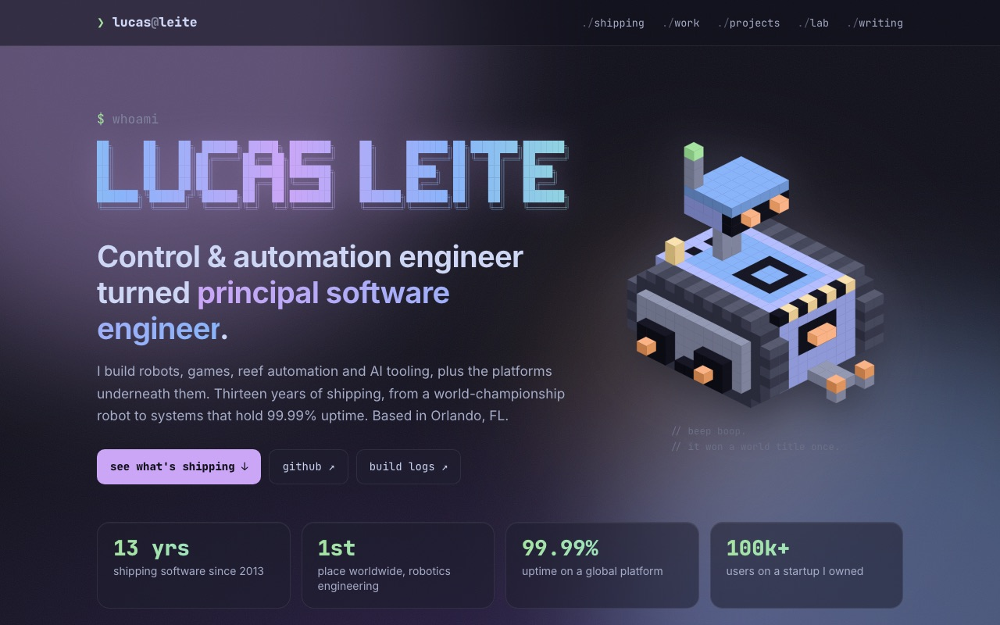
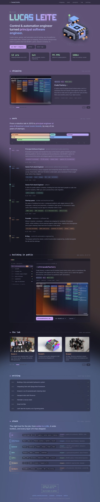

<div align="center">

<a href="https://www.lucasleite.us"></a>

# lucasleite.us

**My corner of the internet: robots, reef automation, a potato tycoon, and thirteen years of shipping.**
<br>Styled like my terminal. Built to be read.

[](https://www.lucasleite.us)


</div>

```text
+--------------------------------------------------------------------+
| 9 pages   ·  fully static  ·  no client components  ·  0 trackers  |
+--------------------------------------------------------------------+
```

## `❯ cat about.txt`

A single-page portfolio that borrows its look from my [Ghostty](https://ghostty.org) setup: **Catppuccin Mocha**,
**JetBrains Mono**, translucent glass with a heavy blur, and a slow-drifting wallpaper. The terminal is the
_accent_, not the interface. Headings, labels and art are monospace; body copy is set in Inter, so it stays
comfortable to read.

| Section         | What's in it                                                                    |
| --------------- | ------------------------------------------------------------------------------- |
| **hero**        | Block-letter banner, a voxel rescue robot, a one-paragraph intro and four stats |
| **01 shipping** | Live products with real screenshots: REEF64, Genesis 22 Studio, Age of Potatoes |
| **02 work**     | Career as a `git log`: roles and outcomes, no company names                     |
| **03 projects** | An editor-style explorer: a `tree` of open-source repos, each with its README   |
| **04 lab**      | The hardware hall of fame: robots and machines, with photos                     |
| **05 writing**  | Build logs on Medium                                                            |
| **06 stack**    | `which --all`                                                                   |

<details>
<summary><b>See the whole page</b></summary>
<br>

</details>

## `❯ ls -la`

```text
app/
├── layout.tsx      fonts (JetBrains Mono + Inter), SEO metadata, viewport
├── page.tsx        every section, as server components, plus JSON-LD
├── chrome.tsx      wallpaper, nav and footer shared by every page
├── projects/       /projects index + one page per repo, README pulled from GitHub
├── explorer.tsx    the projects explorer: a CSS-only tree + README panes, no JS
├── art.tsx         <Banner/> and <Robot/>: the ASCII banner and the voxel rover, drawn as SVG
├── globals.css     Catppuccin palette, glass, wallpaper, responsive layout
├── icon.svg        the ❯_ favicon
├── apple-icon.tsx  the same mark as a PNG, for iOS home screens
├── opengraph-image.jpg  the share card (+ .alt.txt), used for og: and twitter:
└── robots.ts · sitemap.ts · manifest.ts   crawl rules, sitemap with images, web manifest
lib/
└── content.ts      all copy and data: stats, live sites, career, repos, lab, posts
public/
├── shots/          homepage screenshots of the live products
└── lab/            photos of the hardware builds
docs/               README images
```

## `❯ how does it work`

**Content is data.** Everything the page says lives in [`lib/content.ts`](lib/content.ts). Add a project, a
role or a post there, and the page picks it up. You don't need to touch JSX.

**The ASCII is vector, not text.** The `LUCAS LEITE` banner is figlet's _ANSI Shadow_ font. Google Fonts' latin
subsets don't ship the block (`█`) and box-drawing (`╗ ║ ═`) glyphs, so text rendering falls back to another
font with different widths and scrambles the letters. [`art.tsx`](app/art.tsx) reads the banner string at build
time and draws it instead: every `█` becomes a `<rect>`, and every box-drawing character becomes a pair of
strokes for the drop shadow. The gradient fill drifts with a little SMIL.

**The robot is voxels.** An isometric rescue rover in the spirit of the lab's Heimdall: twin tracks that wrap
the whole hull, an armored deck, a gripper and a camera mast. [`art.tsx`](app/art.tsx) builds it from a few
dozen `box()` calls, projects each cube 2:1, sorts back to front and keeps only the faces that aren't buried
against a neighbor, all at build time, so it ships as plain SVG (about 5 KB gzipped). CSS does the rest: the
camera head scans, the lenses blink, the beacon pulses.

**Readability first.** Mono at accent sizes only. Inter for paragraphs at 16.5px / 1.65, `max-width` in `ch`.
ASCII flourishes (`[tags]`, `+` bullets, `01 ---- title` rules) use plain latin characters, so they line up in
any monospace font. Motion turns off under `prefers-reduced-motion`.

**Phones are first-class.** Under 760px the hero stacks with a small robot, the cards go single-column, the
timeline collapses, and the nav scrolls sideways with a fade at the edge. Nothing scrolls horizontally.

**Static all the way down.** Every route prerenders at build time, and images go through `next/image`. The
only client code is small and optional: carousel arrows, phone swiping in the projects explorer, and
remembering scroll position for the back button. Everything works without it.

## `❯ yarn dev`

```bash
yarn install
yarn dev        # http://localhost:3000
yarn lint
yarn build      # static prerender, same as Vercel
```

Requires Node 20+ and Yarn 1.

> [!NOTE]
> This is Next.js 16. APIs and conventions differ from older versions. Check `node_modules/next/dist/docs/`
> before reaching for memory (see [`AGENTS.md`](AGENTS.md)).

## `❯ git push`

Pushing to `main` deploys to production on Vercel. Other branches get preview URLs.

| Host                | DNS record (Squarespace)          |
| ------------------- | --------------------------------- |
| `lucasleite.us`     | `A     @    76.76.21.21`          |
| `www.lucasleite.us` | `CNAME www  cname.vercel-dns.com` |

Mail stays on Google Workspace. Leave the `MX` and `google-site-verification` `TXT` records alone.

## `❯ credits`

[Catppuccin](https://catppuccin.com) for the palette ·
[JetBrains Mono](https://www.jetbrains.com/lp/mono/) and [Inter](https://rsms.me/inter/) for type ·
figlet's ANSI Shadow for the banner ·
[Ghostty](https://ghostty.org) for the inspiration.

```text
+------------------------------------+
| thanks for reading the readme.     |
| the robot says hi.                 |
+------------------------------------+
```
